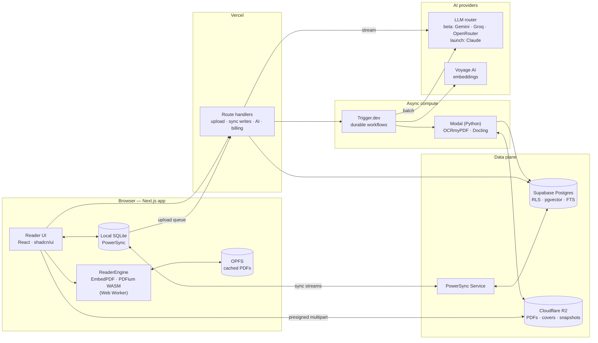

# Architecture

> Status: v1 · 2026-10-26 · Sections marked **Contract** change only through an ADR in `docs/adr/`.

## 1. Shape of the system

Three ideas carry the design:

1. **Local-first user state.** Highlights, notes, cards and reading position live in SQLite in the browser and sync in the background (PowerSync ↔ Postgres). The UI never waits on the network.
2. **Our annotation model, swappable engine.** Annotations are stored in PDF page coordinates plus a text quote. The rendering engine (EmbedPDF, with PDF.js as fallback) sits behind one `ReaderEngine` interface.
3. **Reading is instant; intelligence is async.** A PDF is readable as soon as its bytes land. OCR, structure extraction, chunking and embeddings run in the background and switch AI features on when they finish.



## 2. Stack decisions

| Concern | Choice | Why | Rejected |
|---|---|---|---|
| App framework | **Next.js** (App Router, latest stable) + React + TypeScript | Largest ecosystem, agents are fluent in it; SSR for marketing and SEO; the reader is a client-only route | TanStack Start (younger); SPA-only (loses SEO) |
| UI | **Tailwind v4 + shadcn/ui** (Radix), cmdk, Motion | Accessible primitives, code we own, keyboard-first | MUI (heavy, generic look) |
| PDF engine | **EmbedPDF** (MIT, PDFium → WASM) behind `ReaderEngine`; **PDF.js** (Apache-2.0) as fallback. Final call in WP-02 | Chrome-grade rendering, virtualization, search and selection plugins, MIT license | Nutrient / Apryse (5–6 figures a year); react-pdf (too low-level) |
| Notes editor | **Tiptap** (ProseMirror, MIT core) | Custom node for "quote block linked to a highlight"; JSON storage | Lexical (fewer ready extensions); BlockNote (opinionated UI) |
| Local-first sync | **PowerSync** + Supabase | Mature; offline writes are first-class; client SQLite; official Supabase integration; native SDKs for when we go mobile | Zero 1.0 (great DX; heavy ~700 KB client and historically limited offline writes, so re-evaluate later); Electric (repositioning toward agents); a hand-rolled outbox |
| Database | **Supabase Postgres** + pgvector + full-text search | One database for relational, vector and keyword search; RLS; Auth included | A separate vector DB (unnecessary at our scale) |
| Auth | **Supabase Auth** (Google, Apple, email magic link) | Its JWT plugs straight into RLS and PowerSync | Clerk / Better Auth (one more integration surface) |
| File storage | **Cloudflare R2** | Zero egress fees (PDFs are large and re-downloaded), S3 API, multipart | Supabase Storage / S3 (egress fees) |
| Uploads | **Uppy** + `@uppy/aws-s3` multipart | Resumable large uploads, progress UI | Custom code |
| Workflows | **Trigger.dev** | Durable retries, long jobs, observability, TypeScript-native | Inngest (equivalent; we pick one) |
| Heavy document compute | **Modal** (Python) | Per-second billing, scale to zero, GPU if needed | Self-managed containers |
| OCR | **OCRmyPDF** (MPL-2.0, Tesseract) | Adds a text layer, so scanned books become highlightable and searchable | Cloud OCR API (hold in reserve for hard scans) |
| PDF structure | **Docling** (MIT) | Headings, paragraphs, tables and figures, each with page and bounding-box provenance, so citations land on exact rectangles | Marker (GPL plus model-weight license); MinerU / PyMuPDF (AGPL) |
| Fuzzy re-anchoring | **approx-string-match** (MIT, from Hypothesis) | Proven quote re-anchoring | Custom code |
| Embeddings | **Voyage AI** (voyage-4 family) | Strong retrieval, low cost. The free token allowance per account (~200M, per secondary sources; confirm on the pricing page) covers the whole beta, so this choice doesn't change at launch. Free tokens don't apply to Voyage's Batch API | — |
| LLM | **Beta: free tiers behind a router** (Gemini Flash primary; Groq and OpenRouter `:free` models as fallbacks) on the **Vercel AI SDK**. **Launch: Claude** through an Anthropic SDK adapter | Costs $0 until there's revenue. One feature-level interface means switching is a route change plus an eval run (§6) | Self-hosted open models (GPU cost); Mistral's free plan (trains on API data; access terms in flux) |
| Spaced repetition | **ts-fsrs** (FSRS, MIT) | The algorithm modern Anki uses; best-in-class retention modeling | SM-2 (outdated) |
| Payments | **Stripe Billing**, or a merchant of record (Paddle / Polar / Lemon Squeezy) if the company's country isn't Stripe-supported or you want VAT handled | — | — |
| Email | Resend + React Email | — | — |
| Analytics | PostHog (events, funnels, flags, session replay, LLM analytics) | — | — |
| Errors | Sentry | — | — |
| Rate limits | Upstash Ratelimit | — | — |
| Monorepo | pnpm + Turborepo, Biome, Vitest, Playwright | — | — |

## 3. Data model — Contract

All user tables have `id uuid (v7, client-generated)`, `user_id`, `created_at`, `updated_at` and `deleted_at`. RLS is `user_id = auth.uid()` on every table.

| Table | Key columns | Synced to client |
|---|---|---|
| `documents` | title, author, `sha256`, byte_size, page_count, storage_path, cover_path, has_text_layer, language, outline jsonb, `read_status` (uploading / readable / failed), `ai_status` (none / pending / processing / ready / failed), annotations_imported_at, last_opened_at | ✅ |
| `reading_state` | document_id, page, offset_pt, zoom, percent, seconds_read | ✅ |
| `annotations` | document_id, `kind` (highlight / area / bookmark / ink), `color` (semantic key), **`target` jsonb (§4)**, page_start, quote_text, comment, snapshot_path, tags jsonb, anchor_status (anchored / reanchored / orphaned) | ✅ |
| `notes` | document_id (nullable = standalone note), title, doc_json (Tiptap), plain_text | ✅ |
| `collections`, `collection_documents` | name, sort_order · collection_id, document_id | ✅ |
| `user_settings` | theme, highlight_labels jsonb, reader_prefs jsonb | ✅ |
| `cards` | annotation_id, document_id, `type` (basic / cloze / occlusion), front, back, occlusion jsonb, FSRS state (due, stability, difficulty, reps, lapses, state, last_review), suspended | ✅ |
| `review_logs` | card_id, rating 1–4, reviewed_at, duration_ms, FSRS snapshot. **Append-only** | ✅ |
| `chunks` | document_id, ordinal, heading_path text[], page_start, page_end, `boxes` jsonb [{page, rect}], text, tsv, embedding vector | ❌ server-only |
| `ai_threads`, `ai_messages` | role, content, `citations` jsonb [{chunk_id, page, rects, quote}], model, token counts | ❌ fetched through the API |
| `usage_ledger` | feature, model, input / output / cache-read tokens, cost_micros | ❌ |
| `subscriptions` | plan, status, period_end, provider ids | read-only to the client |

**Conflict policy.**
- Annotations, notes and card metadata: last writer wins per row on `updated_at`. Single-user concurrent edits are rare; if multi-device note editing becomes a real complaint, upgrade notes to Yjs.
- `review_logs` are append-only, and **a card's FSRS state is a deterministic replay of its logs**, so reviews made on two offline devices merge with no conflict.

## 4. Annotation anchoring — Contract (core IP)

```jsonc
// annotations.target
{
  "fingerprint": "sha256:…",          // content hash of the PDF it was made on
  "segments": [                       // usually 1; several when a selection spans pages
    {
      "page": 41,                     // 0-based page index
      "rects": [[72.0, 310.5, 523.2, 324.1]],  // PDF points: page CropBox, unrotated, origin top-left; one rect per line
      "textPos": { "start": 1203, "end": 1288 } // hint only: offsets in the page text
    }
  ],
  "quote": { "exact": "…", "prefix": "…32 chars…", "suffix": "…32 chars…" }
}
```

`annotations.page_start` denormalizes the first segment's page for sorting and filtering.

**Target by kind.** `kind` is its own column, so validation checks `{kind, color, target}` together: a zod union discriminated on `kind`, plus matching DB checks where SQL can express them.

| Kind | Segments | Rects per segment | `textPos` | `quote` / `quote_text` | `color` |
|---|---|---|---|---|---|
| `highlight` | ≥ 1, one per page spanned | ≥ 1, one per line | optional | required | required |
| `area` | exactly 1 | exactly 1: the drawn region | absent | absent / null | optional |
| `bookmark` | exactly 1 | 0, or 1 marking a spot on the page (e.g. an imported sticky note) | absent | absent / null | null |

`ink` is reserved for Phase 4. The DB accepts the value, so no migration is needed later, but the zod schema rejects ink targets until an ADR defines strokes.

- **Why PDF points:** independent of zoom, rotation, device and engine, and they map 1:1 to PDF `/QuadPoints` for export.
- **Rendering:** `ReaderEngine.targetToViewport(target, viewport)` turns the target into screen rects for an overlay layer we own. The engine's own annotation layer is not the source of truth.
- **Anchoring on load:**
  1. Fingerprint matches → render the rects directly (fast path, the common case).
  2. Different file (a new edition or re-upload) → fuzzy-match `quote` on the same page ±3 pages with approx-string-match, recompute the rects from character boxes, and flag the annotation `reanchored`.
  3. No match → **orphaned**: it stays in the panel with its quote and the user can re-place it. Never deleted.
- **Area annotations:** rects only, plus a 2× PNG snapshot rendered on the client and stored in R2. Image-occlusion cards and notebook embeds use it.
- **Export:** rects → `/Highlight` annotations with `/QuadPoints`, comment → `/Contents`, color → `/C`. Exported PDFs open with highlights in Acrobat, Preview and Zotero.
- **Import:** existing highlight annotations in an uploaded PDF are converted into our annotations, so users bring years of old highlights with them.

```ts
// packages/reader — ReaderEngine (shape; final signatures after WP-02)
interface ReaderEngine {
  open(source: ArrayBuffer | URL, opts?: { password?: string }): Promise<DocHandle>;
  pageCount(): number;
  pageSize(page: number): { width: number; height: number; rotation: 0 | 90 | 180 | 270 };
  renderPage(page: number, scale: number, target: OffscreenCanvas | HTMLCanvasElement): Promise<void>;
  pageText(page: number): Promise<{ text: string; charBoxes: Rect[] }>;
  selectionToTarget(sel: EngineSelection): AnnotationTarget;
  targetToViewport(target: AnnotationTarget, vp: Viewport): Rect[];
  search(query: string): AsyncIterable<SearchHit>;
  outline(): Promise<OutlineItem[]>;
  existingAnnotations(): Promise<ImportedAnnotation[]>;
}
```

## 5. Key flows

**5.1 Upload → readable** (budget: < 3 s after the bytes land)
1. The client hashes the file (SHA-256 in a Web Worker). If this user already has it, it opens the existing copy.
2. `POST /api/documents` → presigned multipart URLs → Uppy uploads straight to R2. In parallel, the client caches the file in OPFS and renders page 1 as the cover.
3. `POST /api/documents/:id/complete` → the server checks the magic bytes and size, sets `read_status=readable`, and enqueues `ingest.document`.
4. The user is already reading from the OPFS copy, and annotations work immediately.

**5.2 Ingestion** (async; minutes are fine)
1. Trigger.dev → Modal with pypdfium2: metadata, outline, page sizes, text-layer detection, and import of existing annotations.
2. No text layer → OCRmyPDF writes a text layer → the PDF in R2 is replaced and the fingerprint is mapped old → new.
3. Docling builds the structure → heading-aware chunks of ~500–800 tokens with page and bbox provenance → `chunks`.
4. Voyage embeddings → pgvector (HNSW). `tsv` is filled for keyword search.
5. `ai_status=ready` syncs down, and the AI features switch on for that book.

**5.3 Highlight → persisted → synced**
1. Selection → `selectionToTarget()` → insert into local SQLite → a live query re-renders the overlay (< 50 ms).
2. The PowerSync upload queue sends it to `POST /api/sync/upload` (zod-validated, RLS-enforced) → Postgres.
3. PowerSync streams the change to the user's other devices.

**5.4 Ask the book** (grounded chat)
1. Hybrid retrieval: pgvector top-20 + full-text top-20 → reciprocal rank fusion → top ~8 chunks, plus the chunks of the page currently on screen.
2. Request through the router: stable system prompt and book header + chunks labeled `[C1]…[C8]` + the question. The model returns its answer as sentences, each carrying the chunk id and the **exact quote** that supports it (structured output).
3. **Code verifies every quote** against its chunk's text (approx-string-match, ≥ 0.9 similarity). A verified quote → chunk → (page, boxes) → a citation chip; clicking it opens the page and flashes the rectangles. Sentences whose quote doesn't verify are dropped or marked "not found in the book".
   At launch, the Claude adapter replaces steps 2–3 with Claude's native Citations API (chunks sent as custom-content `document` blocks) and returns the same output shape, so nothing downstream changes.
4. The call is written to `usage_ledger` and credits are deducted. If retrieval found no supporting text, the answer says the book doesn't cover it.

**5.5 Highlight → card → review**
1. `C` on a highlight → **structured output** through the router, built from the highlight + its paragraph + the heading path → 1–3 candidate cards (Q/A, cloze).
2. The user accepts or edits. Cards are never added silently, because card quality drives retention.
3. ts-fsrs schedules them. Review: front → reveal → rate 1–4 → "Show in book" opens the exact passage.

## 6. AI layer

**Abstract at the feature level, not the chat level.** `packages/ai` exposes `explain()`, `askBook()`, `draftCards()`, `summarizeChapter()` and `quiz()`. App code calls only these functions and never imports a provider SDK. Each feature is a small module:

| Part | Contents |
|---|---|
| Prompt | Versioned template + 2–3 few-shot examples drawn from the golden corpus |
| Output schema | zod schema; every response is validated, with one repair retry on failure |
| Route | Ordered provider/model list, e.g. `gemini-flash → groq/<open model> → openrouter/<model>:free` |
| Provider settings | Sampling and provider-specific options, kept **out** of the feature logic |
| Eval set | Gold cases + scoring: citation verification rate, rubric score, card quality |

Switching a feature to Claude means adding a Claude route, running that feature's eval, and flipping the route. Nothing outside `packages/ai` changes.

### Beta mode: free tiers ($0)

- **Router:** Vercel AI SDK providers (`@ai-sdk/google`, `@ai-sdk/groq`, the OpenRouter provider). A 429 or timeout falls through to the next provider in the route. Per-provider daily counters (Upstash) and a circuit breaker skip any provider that's out of quota for the day.
- **Primary: Gemini Flash** (free tier via AI Studio): the best free quality, long context, JSON-schema output. Quotas apply per Google Cloud project and are shown live in AI Studio. Pro models are no longer on the free tier.
- **Fallbacks:** Groq (fast open models, no card required, good for inline actions) → OpenRouter `:free` models (20 requests/min; 50 requests/day, or 1,000/day once the account has bought $10 of credit at least once).
- **Capacity:** a 30-person beta at realistic usage is roughly 50–150 AI calls a day, which fits within these free tiers combined. The limits change often, so re-check each console before the beta opens.

### Techniques that make free models perform (and carry over to Claude)

1. **Tight grounding.** Send only what's needed: for inline actions, the selection + its paragraph + the heading path; for chat, labeled chunks. Smaller models do better with less, cleaner context.
2. **Citations verified in code** (§5.4). The model must quote its source, and code checks the quote really exists. That keeps "grounded or silent" true even on weaker models.
3. **Schema-constrained output**, zod validation, and one repair retry, instead of trusting free-form text.
4. **Few-shot examples** per feature (2–3 gold examples), versioned with the prompt.
5. **Draft, then self-check, in one call** for cards: generate candidates, check each against a rubric (one fact, unambiguous, answerable from the passage), and output only the ones that pass.
6. **Sparing use of sampling.** Low temperature (~0.2–0.4) for explanations, chat and cards. For variety (several card candidates), ask for N candidates **in one call**, never N calls, because free quotas count requests. Use self-consistency (several samples + a vote) for quiz-answer grading at most.
7. **Answer cache** keyed by (document sha256, passage hash, action, prompt version), so reopening an explanation uses no quota.
8. **Sampling settings live in provider config only.** Claude's current API rejects `temperature`, `top_p` and `top_k` and is steered with effort level and the prompt instead. Keeping sampling out of feature logic is what makes the switch painless.

### Launch mode: Claude

- A Claude adapter on the official Anthropic SDK (load the `claude-api` skill): native **Citations API** for `askBook`, prompt caching on the stable prefix, effort `low` for inline actions and `medium` for chat, server-side refusal fallback, and the Batch API (−50%) for precomputation where nobody is waiting.
- The model for each feature is chosen by eval (WP-37): `claude-opus-5-5` by default, `claude-haiku-5-5` wherever quality holds (cost in §9).
- Free tiers can remain an overflow route for Free-plan users, if their data terms still fit.

### Always

- **Prompt injection:** book text is data. Book chat has no tools with side effects, and the system prompt tells the model to treat document content as untrusted.
- **Metering:** a ledger row per call (provider, model, tokens, cost; $0 during beta), credits per plan checked server-side **before** the call, and a per-user rate limit. Beta users get the planned Free/Pro credit limits, so the beta measures real usage.

## 7. Performance budgets

| Metric | Budget |
|---|---|
| First page, cached book | < 300 ms |
| First page, first open (50 MB, broadband) | < 2 s |
| Highlight → visible and persisted locally | < 50 ms |
| Scrolling | 60 fps on a mid-range laptop |
| Tab memory, 1,000-page PDF | < 500 MB |
| Local search (titles, highlights, notes) | < 100 ms |
| Ask the book, time to first token | < 2 s |
| Upload → readable | < 3 s after bytes land |

How: PDFium in a Web Worker, page virtualization, tiled rendering at high zoom, OPFS cache, prefetching the next pages, and HTTP range loading if the chosen engine supports it (verified in WP-02).

## 8. Security and privacy

- RLS on every table. PowerSync sync rules mirror RLS. CI runs a two-user test proving user B sees zero rows of user A on every table and stream.
- R2 bucket is private. Keys look like `u/{user_id}/d/{document_id}/source.pdf`. Presigned GET URLs expire in ≤ 10 minutes.
- PDFs are hostile input: parse and render in a worker, never execute PDF JavaScript, strict CSP, keep the engine patched (the PDF.js CVE-2024-4367 class of bugs).
- Upload validation: `%PDF-` magic bytes, per-plan size and page caps. Passwords for encrypted PDFs stay on the client and are never stored.
- Copyright: libraries are private. Sharing covers notes and highlights only, with capped quote length, never files. Publish a DMCA contact and takedown process before public launch.
- GDPR: account deletion cascades through Postgres, R2 and vectors within 30 days. Full data export (JSON, Markdown, annotated PDFs).
- Never share files across users. Reusing derived chunks for identical `sha256` across users would cut costs but needs legal review first.
- **Beta AI data terms:** Gemini's free tier allows Google to use prompts for training and to have humans review them, and other free tiers have similar terms. The beta invite and privacy notice must say so plainly, and AI features are opt-in per user during the beta. Make no "private AI" claims until AI traffic runs on paid terms (Claude at launch).

## 9. Unit economics (estimates to verify in beta)

**During the beta, AI and embeddings cost $0** on free tiers (§6, §12). The table below is the launch picture on Claude.

Heavy Pro user per month: 2 new books, 60 inline AI actions, 40 chat turns, 100 card drafts.

| Item | Opus 5.5 everywhere | Haiku 5.5 for inline + cards |
|---|---|---|
| R2 storage (~250 MB) | ~$0.004 | ~$0.004 |
| Ingestion compute (2 books) | ~$0.02–0.10 | same |
| Embeddings (~600k tokens) | ~$0.05 | same |
| Inline AI (~2.5k in / ~500 out incl. thinking) | ~$1.20 | ~$0.03 |
| Chat (~10k in, ~40% cached / ~700 out) | ~$1.60 | ~$1.60 |
| Card drafts (~1.5k in / ~400 out) | ~$1.40 | ~$0.04 |
| **Total** | **~$4.30** | **~$1.75** |

The median user will cost far less than this heavy user. At ~$10/mo Pro, the Haiku routing is the difference between ~43% and ~18% AI cost for heavy users, so it's worth building the eval harness early to decide with data. Once you're past the free tiers, the paid platform floor is roughly $150–250/mo (Vercel, Supabase, PowerSync, Trigger.dev, Modal); confirm against current vendor pricing.

If free-tier quotas or data terms become a problem during the beta, running it entirely on `claude-haiku-5-5` costs about $0.10–0.15 per heavy user a month, roughly $4/month for 30 heavy users, and it brings native citations with it.

## 10. Observability

- **PostHog events:** `document_uploaded`, `document_opened`, `highlight_created {color, kind}`, `note_created`, `ai_action {type}`, `citation_clicked`, `card_created {source}`, `review_completed {rating}`. Activation and retention funnels from day one.
- **Sentry** for web and the ingest worker, with source maps. Sync errors surfaced as their own category.
- **AI dashboard:** latency, cost, refusal rate and citation click-through per feature.

## 11. Decision log

| ADR | Decision | Status |
|---|---|---|
| 0001 | Annotations stored in PDF space + text quote (W3C-shaped) | Accepted |
| 0002 | PowerSync + Supabase for local-first sync | Accepted |
| 0003 | Reader engine: EmbedPDF vs PDF.js | Pending (WP-02 spike) |
| 0004 | Docling for structure; no AGPL dependencies | Accepted |
| 0005 | AI providers: free tiers behind a feature-level router for the beta; Claude at launch, with the model per feature chosen by eval | Accepted for beta · launch models pending WP-37 |

## 12. Bootstrap mode ($0 until revenue)

Every service in §2 has a free tier that covers a closed beta. Check each vendor's current limits before relying on them.

| Service | Free-tier catch |
|---|---|
| Vercel Hobby | Non-commercial use only: move to Pro before the first paying customer |
| Supabase Free | Projects pause after a period of inactivity; small database and storage caps |
| Cloudflare R2 | Free storage allowance; egress is always free |
| PowerSync, Trigger.dev, PostHog, Sentry | Free tiers sized for small user counts |
| Modal | Monthly free compute credits cover OCR and Docling for beta uploads |
| Voyage AI | The free token allowance covers beta embeddings |
| LLMs | Free tiers through the router (§6) |

**Personal MVP** (`prompts/`): files live in **Supabase Storage** behind a `StorageProvider` interface, because R2 asks for a payment method even on its free tier. Supabase Free allows 50 MB per file and 1 GB in total. R2 becomes a second implementation when bigger files or the launch require it. The other temporary simplifications are listed in `prompts/README.md`.

**Credits worth applying for now**, since they can pay for Claude before there's revenue:
- **AWS Activate:** since May 2026, its credits can be spent on third-party models on Amazon Bedrock, including Claude. Some account types hit a Marketplace-subscription step, so test with one small call first. If the credits come through Bedrock, the Claude adapter uses the SDK's Bedrock client; check which features (e.g. Citations) Bedrock supports.
- **Anthropic's startup program:** credits on the first-party API, usually offered through partner accelerators and VCs.
