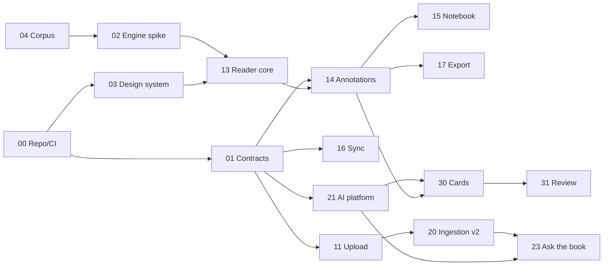

# Roadmap and agent orchestration

> Status: v1 · 2026-10-26

## Decisions needed from the founder (these block Phase 1)

| # | Decision | Default if you don't choose |
|---|---|---|
| 1 | Beachhead audience | Exam students (medicine, law) |
| 2 | UI languages and data region | English + French UI, RTL-ready; EU region |
| 3 | Payments | Stripe if your company's country is supported; otherwise a merchant of record |
| 4 | AI cost policy | **Decided 2026-10-26:** free tiers behind a router for the beta; Claude at launch, with the model per feature chosen by eval (WP-37) |
| 5 | Product name and domain | Codename "Margin" |

## Current track: personal MVP (no AI, no payments)

Decided 2026-10-26: build Phase 0 + Phase 1 for the founder's own use first; AI (Phase 2) and billing (Phase 3) follow. Step-by-step agent prompts live in `prompts/`; start with `prompts/README.md`. WP-18 (telemetry) and WP-19 (beta operations) are dropped for now. The temporary simplifications (Supabase Storage instead of R2, direct sync writes, email-only auth) are listed in `prompts/README.md`.

## Phases

| Phase | Goal | Exit criteria | Estimate* |
|---|---|---|---|
| **0 · Foundations** | Contracts frozen, engine chosen | ADR-0003 accepted; schema + RLS + sync rules merged; CI green | 1 week |
| **1 · Read & Capture** | The best PDF reader with highlights and notes that never get lost | Closed beta with 30+ users; activation ≥ 40% | 4 weeks |
| **2 · Understand** | AI grounded in the page | ≥ 95% of answer sentences backed by a verified quote on the eval set | 3 weeks |
| **3 · Retain & Monetize** | Highlight → card → review loop; billing; public launch | First paying users | 3 weeks |
| **4 · Expand** | Tablet and mobile, integrations, EPUB | — | Ongoing |

\* Calendar time with about 4 agents working in parallel and daily orchestrator review.

## Lanes

A Platform · B Reader · C Annotation core · D Ingestion · E Sync · F AI · G Learning · H Design/UX · I Growth

## Work packages

### Phase 0 — Foundations

| WP | Lane | Scope | Depends on | Acceptance criteria |
|---|---|---|---|---|
| **00** | A | `git init`, GitHub repo, pnpm + Turborepo skeleton following CLAUDE.md, Biome, Vitest, Playwright, GitHub Actions, Vercel preview deploys; dev and prod projects for Supabase, R2 and PowerSync | — | CI passes on the skeleton; each PR gets a preview URL; `.env.example` complete; the CLAUDE.md "Commands" section filled in |
| **01** | A/C/E | **Contracts:** Drizzle schema, migrations and RLS for ARCHITECTURE §3; `annotation-model` types, zod schemas and coordinate transforms; PowerSync sync rules | 00 | Migrations apply to a fresh DB; the two-user RLS test passes on every table and stream; transforms round-trip page ↔ viewport within 0.5 pt (property tests over 4 zoom levels × 4 rotations) |
| **02** | B | **Engine spike:** EmbedPDF vs PDF.js on the golden corpus. Also decide: our own overlay layer vs the engine's annotation plugin (default: our overlay) | 04 | ADR-0003 with measured first-page time, memory on 1,000 pages, selection accuracy on two-column and RTL files, range-loading support, bundle size, and a decision |
| **03** | H | Design system: tokens for light, sepia and dark; type scale; highlight palette passing WCAG contrast in all three themes and colorblind-safe; reader layout spec; shadcn installed. Use the `design-system` and `ui-ux-pro-max` skills | 00 | Tokens in `packages/ui`; a `/dev/ui` page shows every component in every theme |
| **04** | B | Golden PDF corpus from license-safe sources (OpenStax CC-BY textbooks, arXiv CC-BY papers, Internet Archive public-domain scans), listed below | — | `fixtures/pdfs/` with a README describing what each file tests |

Golden corpus: a 600+ page textbook with an outline · a scanned book with no text layer · a two-column paper with equations · slides exported to PDF · an Arabic (RTL) document · a French course with accents and ligatures · a 150 MB+ image-heavy atlas · a password-protected PDF · mixed page sizes and rotated pages · a corrupted file (must fail gracefully) · a PDF with existing highlight annotations · a PDF with JavaScript and forms (security).

### Phase 1 — Read & Capture

| WP | Lane | Scope | Depends on | Acceptance criteria |
|---|---|---|---|---|
| **10** | A | Auth (Google, Apple, magic link) and onboarding ("Drop your first PDF") | 01 | Sign-up to reading in under 60 s |
| **11** | D | Upload: Uppy multipart → R2; client SHA-256 and per-user dedupe; server validation; cover; import of existing highlights; OCRmyPDF on Modal for scanned files | 01 | A 300 MB upload survives a network drop; readable < 3 s after bytes land; the scanned fixture becomes selectable; the fixture's existing highlights appear as annotations |
| **12** | B/H | Library: grid and list, covers, progress, sort and filter, collections, offline badge | 10, 11 | Interactive in < 1 s with 200 books |
| **13** | B | Reader core on the chosen engine: virtualization, zoom and fit, outline, thumbnails, find, themes, resume position, OPFS cache, keyboard navigation, ⌘K | 02, 03 | All ARCHITECTURE §7 budgets met on the corpus; resume lands within ±1 line across devices |
| **14** | C/B | Annotation layer: selection popover, semantic colors, area snapshot, comment, bookmark, edit, delete and undo, shortcuts | 01, 13 | Highlights render within ≤ 1 px of their position after reload at 50/100/200/300% on every corpus file (Playwright visual tests) |
| **15** | H/C | Annotations panel and Notebook: Tiptap, drag a highlight in to make a linked quote block, backlinks | 14 | Clicking any annotation or quote opens its exact location and flashes it |
| **16** | E | Sync: PowerSync client, upload connector, offline indicator, conflict policy | 01 | 50 annotations made in airplane mode reach a second device < 5 s after reconnecting; a chaos test (killing the tab mid-write) loses nothing |
| **17** | C | Export v1: Markdown/Obsidian with deep links; annotated PDF with real `/Highlight` annotations | 14 | Exported PDFs show highlights and comments in Acrobat, Preview and Zotero |
| **18** | I | Telemetry: PostHog events and funnels, Sentry | 10 | Activation funnel dashboard is live |
| **19** | I | Beta operations: waitlist landing page, invite codes, in-app feedback widget | — | Invite flow works end to end |

### Phase 2 — Understand

| WP | Lane | Scope | Depends on | Acceptance criteria |
|---|---|---|---|---|
| **20** | D | Ingestion v2: Docling → heading-aware chunks with page and bbox → Voyage embeddings → pgvector + full-text, orchestrated by Trigger.dev | 11 | A 500-page book processes in < 5 min; every chunk has ≥ 1 bbox; re-running is idempotent |
| **21** | F | AI platform (ARCHITECTURE §6): feature-level API; provider router on the Vercel AI SDK (Gemini → Groq → OpenRouter fallback, daily quota counters, circuit breaker); prompt registry with few-shot examples; zod validation with one repair retry; answer cache; usage ledger; credits; rate limits; eval harness | 01 | Every feature has an eval set; disabling the primary provider mid-session falls through to the next with no user-visible error; every call lands in the ledger |
| **22** | F/B | Inline actions: explain, define, simplify, translate → save to the highlight | 21, 14 | Median time to first token < 1.5 s; saving as a note takes one click |
| **23** | F | Ask the book: hybrid retrieval + quote-verified citations → jump and flash | 20, 21 | ≥ 95% of answer sentences backed by a verified quote on the eval set; every citation chip lands on the right rectangle; declines when the book has no support |
| **24** | D | Library-wide hybrid search over titles, full text, annotations and notes | 20 | Relevant results in < 300 ms |

### Phase 3 — Retain & Monetize

| WP | Lane | Scope | Depends on | Acceptance criteria |
|---|---|---|---|---|
| **30** | G/F | Cards: highlight → card (structured output, 1–3 candidates, accept or edit), cloze, image occlusion from area snapshots, suggestions for purple highlights | 21, 14 | Median time from highlight to accepted card < 5 s |
| **31** | G | Review: ts-fsrs scheduling, daily queue, keyboard review UI, "Show in book", card state replayed from review logs | 30 | Replaying the same logs on two devices produces identical schedules |
| **32** | G/H | Progress: streaks, reading time, chapter coverage, mastery | 31 | — |
| **33** | A | Billing and entitlements, paywall moments, plan limits enforced server-side | 21 | Upgrade, downgrade, cancel and failed-payment paths are tested |
| **34** | G | Anki `.apkg` export including images and deep links back to the book | 30 | The deck imports into Anki desktop and AnkiDroid |
| **35** | I | Public launch: SEO landing page, onboarding emails (Resend), help docs | — | — |
| **36** | A | Pre-launch security pass: `/security-review`, RLS audit, upload and presigned-URL abuse tests, prompt injection through PDF text, DMCA process | all | No open high-severity findings |
| **37** | F | Switch to Claude for launch: Claude adapter on the Anthropic SDK (native Citations, prompt caching, effort levels; load `claude-api`); eval of beta providers vs `claude-haiku-5-5` vs `claude-opus-5-5` per feature → founder picks (ADR-0005) | 21–23, 30 | Side-by-side quality and cost per feature; the switch is a route change only; the privacy notice is updated |

### Phase 4 — Expand (parking lot)

PWA for tablets with stylus ink → a React Native (Expo) app reusing `annotation-model`, `sync` and `srs` · reflow mode built on the Docling structure · EPUB (same annotation model with CFI selectors) · Notion, Obsidian, Readwise and Zotero integrations · shared decks and study groups · read-aloud.

## Critical path



Critical path: **01 → 13 → 14 → 30 → 31**. The reader (13) and the annotation layer (14) get the strongest agent and the most review attention.

## Orchestration protocol

1. **Contract-first.** Phase 0 freezes the contracts. In later phases, each agent changes only its own package; contract changes go through an ADR.
2. **One WP = one agent = one branch in its own git worktree.** At most about 4 agents in parallel, picked from the dependency graph.
3. **Handback = PR + evidence:** test output, Playwright screenshots or video for UI, and measured numbers wherever a performance budget applies.
4. **Review gate:** `/code-review` → the orchestrator checks the acceptance criteria → merge. Auth, storage and RLS changes also get `/security-review`.
5. **Weekly integration checkpoint:** the full E2E suite runs against the golden corpus on `main`, and budgets are re-measured.

### Agent brief template

```markdown
# WP-XX — <title>
Goal: <one sentence, user-visible outcome>
Read first: CLAUDE.md · docs/ARCHITECTURE.md §<n> · <specific files>
You own: <packages/paths>. Do not modify: <contracts / other packages>.
Interfaces to honor: <types / endpoints / events>
Deliverables: <list>
Acceptance criteria: <copied from ROADMAP; each one verifiable>
Out of scope: <list>
Verify: <commands> + evidence to attach to the PR
Blocked by a contract gap? Stop and report; don't work around it.
```

### Tooling to connect before Phase 0

| Tool | Used for | Who sets it up |
|---|---|---|
| Context7 MCP | Current docs for fast-moving libraries | Founder (`claude mcp add`) |
| Supabase MCP | Schema, migrations, logs | Founder (needs a Supabase token) |
| Playwright MCP | Agents verifying UI in a real browser | Founder |
| GitHub CLI (`gh`) | PRs, CI status | Founder (`gh auth login`) |
| Sentry, PostHog, Stripe MCPs | Phases 1–3 | Founder, when each phase starts |

Skills already available here: `claude-api`, `ui-ux-pro-max`, `ui-styling`, `design-system`, `code-review`, `security-review`, `simplify`.

## Risks

| Risk | Mitigation |
|---|---|
| EmbedPDF is a young project | `ReaderEngine` adapter; PDF.js fallback validated in the spike |
| Highlights drift across zoom levels or engines | PDF-space storage + visual regression tests on the golden corpus |
| Scanned PDFs can't be highlighted | OCRmyPDF adds a text layer at upload |
| AI costs run away | Credits checked before each call, caching, Batch API, Haiku routing once evals allow |
| Free-tier quotas run out mid-beta | Fallback chain across 3 providers, answer cache, per-user credits; ~$5 of Claude Haiku 5.5 credit as emergency overflow |
| Free-tier data terms (training, human review) | Disclosed in the beta invite; AI features opt-in during beta; Claude on paid terms at launch |
| Weaker answers from free models | Grounding, quotes verified in code, schema validation, few-shot examples; evals catch regressions |
| Copyright / DMCA exposure | Private libraries, no file sharing, takedown process |
| Sync data loss | Local-first writes, append-only review logs, chaos tests |
| Scope creep | Phase exit criteria are gates; Phase 4 is the parking lot |
